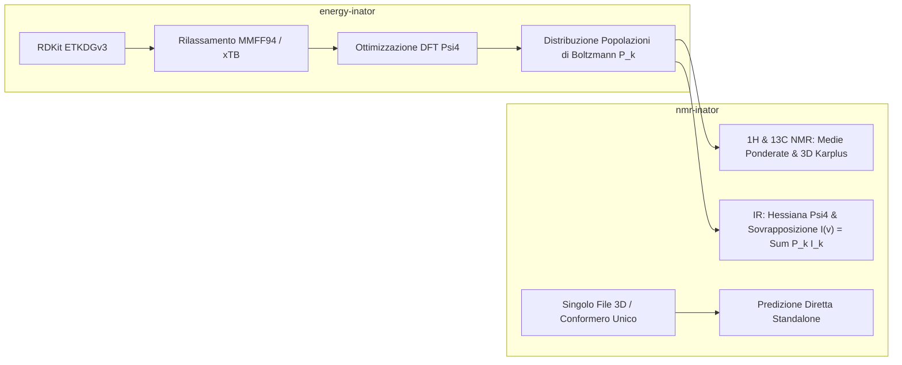

# NMR-INATOR: Quantum & Ensemble Spectroscopy Suite

**NMR-INATOR** è una suite di chimica computazionale e spettroscopia predittiva in Python progettata per simulare spettri **NMR (¹H, ¹³C)** e **Infrarosso (IR)** ad alta fedeltà fisica, sfruttando motori quantistici (*ab initio* / DFT con **Psi4**), regole topologiche di simmetria (**RDKit**) e campionamento conformazionale ponderato su distribuzioni di **Boltzmann** tramite integrazione con **energy-inator**.

---

## Caratteristiche Principali

### 1. Spettroscopia NMR (¹H e ¹³C)
* **Chemical Shifts Predetti**: Calcolo di spostamenti chimici accurati basati su codici HOSE (interfaccia online Zakodium / NMRDB con fallback euristico robusto offline).
* **Equivalenze Chimiche e Simmetria Topologica**: Raggruppamento automatico di nuclei simmetricamente o conformazionalmente equivalenti (es. rotazione rapida dei gruppi metilici $-\text{CH}_3$, anelli aromatici simmetrici) per generare le corrette integrazioni ($1\text{H}, 2\text{H}, 3\text{H}$, ecc.).
* **Effetti Geometrici 3D**:
  * **Accoppiamenti Scalari $^3J_{\text{HH}}$ di Karplus**: Calcolo delle costanti di accoppiamento dai veri angoli diedri conformazionali 3D.
  * **Anisotropia Magnetica e Correnti d'Anello (Modello di McConnell)**: Schermatura upfield (verso campi alti) e deschermatura indotte dalla corrente d'anello degli anelli aromatici.
  * **Legami a Idrogeno Intramolecolari**: Spostamenti verso campi bassi (downfield) per protoni $-\text{OH}$ e $-\text{NH}$ chelati.
* **Simulazione Line-Shape Realistica**: Profilo continuo convoluto lorentziano con sdoppiamento in multipletti (singoli, doppietti, tripletti, quartetti, doppi doppietti, multipletti complessi) e traccia cumulativa dell'integrale.
* **Convenzione Spettroscopica**: Asse $\delta$ (ppm) invertito da destra (0 ppm) a sinistra (12-14 ppm o 220 ppm per ¹³C).

### 2. Spettroscopia Infrarossa (IR Vibrazionale - Psi4)
* **Matrice Hessiana e Modi Normali**: Calcolo quantistico *ab initio* / DFT con Psi4 di tutte le frequenze armoniche $\nu_i$ e delle intensità dipolari $I_i$ ($\text{km/mol}$).
* **Fattori di Scala Armonica**: Correzione automatica dell'anarmonicità in base al metodo e al basis set (database NIST CCCBDB, es. 0.965 per B3LYP).
* **Convoluzione di Riga**: Simulazione dello spettro continuo sia in **% Trasmittanza (%T)** (picchi verso il basso con linea base al 100%) che in **Assorbanza**.
* **Riconoscimento Bande Diagnostiche**: Etichettatura automatica delle bande funzionali (Carbonili $\text{C=O}$, Ossidrili $\text{O-H}$, Ammine, Alchini, Alcheni, Aromatici, C-H alifatici).

### 3. Modalità di Esecuzione

| Modalità | Descrizione | Quando Usarla |
| :--- | :--- | :--- |
| **Modalità Completa (Ensemble Boltzmann)** | Esegue la ricerca conformazionale completa con `energy-inator` (RDKit $\to$ MMFF94 $\to$ Psi4), calcola le energie relative $\Delta E$ e le popolazioni di Boltzmann $P_k$, e genera lo **spettro reale medio in soluzione**: <br>• $\langle \delta \rangle = \sum_k P_k \delta_k$ (media temporale NMR)<br>• $I_{\text{IR}}(\nu) = \sum_k P_k I_k(\nu)$ (somma istantanea IR) | Per molecole flessibili e per confrontare le predizioni con spettri sperimentali registrati a temperatura ambiente. |
| **Modalità Singola (Conformero Unico)** | Ottimizza con Psi4 o calcola direttamente le proprietà spettrali sul singolo conformero 3D fornito. | Per calcoli rapidi (pochi secondi), per file `.xyz` già ottimizzati esternamente, o per studiare le differenze spettrali di una singola conformazione. |

### 4. Esportazione nei Formati Standard
* **JCAMP-DX (`.jdx`)**: Formato ufficiale IUPAC per spettri NMR e IR, compatibile nativamente con **MestReNova, Bruker TopSpin, Varian, ACD/Labs**.
* **Tabelle CSV**: Elenco picchi, costanti $J$, integrali, frequenze e intensità.
* **Report JSON Completo**: Tutti i metadati, conformeri e serie numeriche.

---

## Architettura e Relazione con `energy-inator`

`nmr-inator` è progettato per operare in stretta sinergia con il framework sibling [**energy-inator**](https://github.com/sirfilips/energy-inator):



### Gestione della Dipendenza
1. **Installazione Automatica da GitHub**: `energyinator` è formalmente dichiarato in `pyproject.toml` come dipendenza remota (`energyinator @ git+https://github.com/sirfilips/energy-inator.git`). Durante una nuova installazione pulita (`pip install -e .`), `pip` installerà automaticamente `energy-inator`.
2. **Ambiente di Sviluppo Condiviso (Sviluppo Locale)**: Se hai clonato `energy-inator` nella stessa cartella madre (cartella adiacente `../energy-inator`), puoi condividere lo stesso ambiente Python o installarlo in modalità editable con:
   ```bash
   pip install -e ../energy-inator
   ```
3. **Funzionamento Modulare**:
   * **Modalità Singola**: Opera in modo completamente autonomo con RDKit e Psi4 per qualsiasi singolo conformero o file `.xyz`/`.mol` 3D.
   * **Modalità Completa**: Invoca il motore di ricerca conformazionale e termodinamica di `energy-inator` per generare lo spettro ponderato su Boltzmann.

---

## Installazione e Setup

### 1. Prerequisiti: Ambiente Conda con Psi4
Poiché il motore quantistico **Psi4** è distribuito come pacchetto binario multipiattaforma ottimizzato con librerie C++, è consigliato creare un ambiente Conda dedicato (oppure utilizzare l'ambiente Conda già creato per `energy-inator`):

```bash
# Crea un ambiente Conda con Python, Psi4 e RDKit
conda create -n nmrinator -c conda-forge psi4 rdkit python=3.10
conda activate nmrinator
```

### 2. Installazione di NMR-INATOR
Clona il repository e installalo in modalità modificabile (editable):

```bash
git clone https://github.com/sirfilips/nmr-inator.git
cd nmr-inator

# Installa tutte le dipendenze (incluso energy-inator da GitHub)
pip install -e .
```

---

## Utilizzo da Riga di Comando (CLI)

Il pacchetto espone l'entrypoint da terminale `nmrinator` (o `python -m nmrinator.cli`):

```bash
# 1. Calcolo rapido in modalità singola (1H e 13C NMR su etanolo)
python -m nmrinator.cli --smiles "CCO" --mode single --no-ir

# 2. Calcolo completo con IR quantistico (Psi4 B3LYP/6-31G*) e NMR su singolo conformero
python -m nmrinator.cli --smiles "CC(=O)C" --mode single --method b3lyp --basis 6-31G(d)

# 3. Calcolo ensemble completo di Boltzmann (richiede energy-inator)
python -m nmrinator.cli --smiles "CCCC" --mode full --confs 30 --top-confs 3

# 4. Input diretto da file di coordinate 3D (.xyz o .mol)
python -m nmrinator.cli --xyz molecola.xyz --mode single
```

Tutti i risultati, file `.jdx`, tabelle `.csv` e report `.json` vengono salvati automaticamente all'interno della cartella `output/session_YYYYMMDD_HHMMSS_<formula>/`.

---

## Interfaccia Web Interattiva (Streamlit GUI)

Per avviare lo Studio Spettroscopico:
* **Windows (1-Click)**: Doppio clic sul file `avvia_gui.bat` (rileva automaticamente l'ambiente virtuale locale `.venv`, l'ambiente adiacente `..\energy-inator\.venv` o l'ambiente Conda attivo).
* **Da Terminale**:
  ```bash
  streamlit run gui/app_gui.py
  ```

Funzionalità dell'interfaccia:
* **Editor Molecolare 2D (Ketcher)**: Disegna la molecola in tempo reale o seleziona un template.
* **Console di Avanzamento in Tempo Reale**: Tracciamento passo-passo del calcolo quantistico con pulsante **STOP** per interruzione immediata senza bloccare il server.
* **Archivio Sessioni**: Esplora e ricarica con un click le sessioni precedenti salvate nella cartella `output/`.
* **Spettri Interattivi Plotly**: Zoom, ispezione picchi e tabelle dei segnali per ¹H NMR, ¹³C NMR e IR (commutabile tra % Trasmittanza e Assorbanza).
* **Download Standard e Grafici**: Esportazione istantanea in **JCAMP-DX** (`.jdx`), **CSV**, **JSON**, e grafici ad alta risoluzione (**PNG**, **SVG**).
